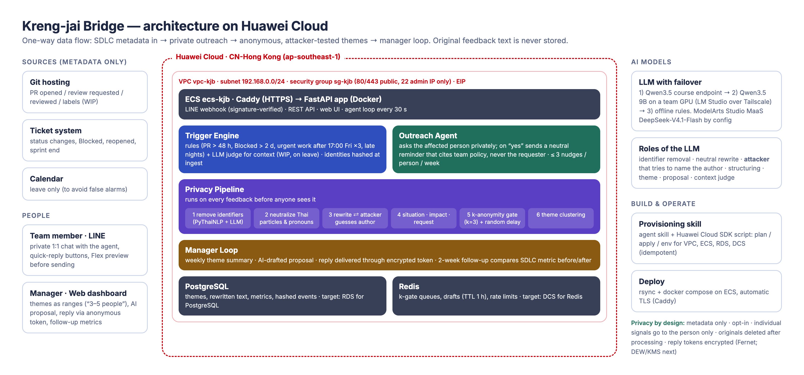

# Kreng-jai Bridge

A proactive AI agent in LINE that says what Thai team members are too *kreng-jai* to say. It watches SDLC
metadata (never chat content), asks the affected person privately, and then acts for them: a neutral reminder
that cites team policy, or anonymous feedback that an LLM attacker has failed to trace back to its author.

Huawei ICT Competition 2026 · Innovation Track · Topic 1 (AI applications powered by Huawei Cloud).

- Live demo: https://119-13-81-32.sslip.io (`/manager` dashboard, `/demo` presenter console)
- LINE Official Account: `@075bvvrs`
- Build contract and API: [docs/ARCHITECTURE.md](docs/ARCHITECTURE.md)
- Evaluation report (synthetic data): [eval/results/REPORT.md](eval/results/REPORT.md)



## How it works
1. **Observe**: rules over hashed SDLC events (PR waiting > 48 h for a more senior reviewer, ticket Blocked > 2 days,
   urgent work after 17:00 on Fridays ×3 in 4 weeks, late-night commits) plus context checks (WIP, reviewer on leave); an LLM judge can be switched on (`LLM_JUDGE_ENABLED`).
2. **Ask**: a private LINE message with buttons; at most 3 per person per week; "not useful" and "mute" always available.
3. **Act**: a neutral reminder that never names the requester, or anonymous feedback through the privacy pipeline:
   identifier removal → Thai particle/pronoun neutralization → rewrite ⇄ LLM attacker → situation/impact/request →
   k-anonymity gate (k = 3, counts shown as ranges) → theme clustering.
4. **Close the loop**: weekly themes for the manager with an AI-drafted proposal, replies through an encrypted
   anonymous token, and a two-week follow-up that re-measures the SDLC metric.

## Run locally
```bash
uv sync
cp .env.example .env   # set LLM_API_KEY; LINE keys optional (web inbox fallback)
uv run uvicorn app.main:app --reload
uv run pytest -q
```
Open http://localhost:8000/demo.

## Code quality
Ruff formats (the Prettier of this repo) and lints (the ESLint); ty type-checks (the `tsc`). All three are dev
dependencies pinned in `uv.lock` and configured in `pyproject.toml`.
```bash
uv run ruff format .        # format          (check only: --check)
uv run ruff check --fix .   # lint + safe fixes (check only: drop --fix)
uv run ty check             # types (ty is beta: 0.0.x)
uv run pre-commit install   # once per clone: runs the three on every commit
uv run pre-commit run --all-files
```
VS Code: install the recommended extensions (`.vscode/extensions.json`); Python files format and fix on save.

## Deploy (Huawei Cloud)
- Today: one pay-per-use ECS in CN-Hong Kong running `deploy/docker-compose.yml` (app + PostgreSQL + Redis) behind Caddy.
  `deploy/deploy.sh` syncs and rebuilds.
- Managed services: `skills/huawei-cloud-provision/` is an agent skill + Huawei Cloud SDK script that provisions
  VPC, ECS, RDS for PostgreSQL and DCS for Redis (`plan` / `apply` / `env`). Switching from containers to RDS/DCS
  only changes `DATABASE_URL` and `REDIS_URL`.
- LLM: any OpenAI-compatible endpoint (`LLM_BASE_URL`, `LLM_API_KEY`, `LLM_MODEL`); ModelArts Studio MaaS
  (`https://api-ap-southeast-1.modelarts-maas.com/v2`, `deepseek-v4.1-flash`) once an API key is available.
- Self-hosted: Ollama on a team GPU reached over Tailscale (`LLM_API_STYLE=ollama`): spec [docs/GPU_ENDPOINT_SPEC.md](docs/GPU_ENDPOINT_SPEC.md), guide [docs/OLLAMA_TAILSCALE.md](docs/OLLAMA_TAILSCALE.md) (Thai).
- LINE OA setup: [docs/submission/LINE_SETUP.md](docs/submission/LINE_SETUP.md) (Thai).

## Demo video
`uv run scripts/record_demo.py` records the web walkthrough with captions (first run: `uv run --with playwright playwright install chromium`).
Full guide incl. recording LINE and editing: [docs/RECORDING.md](docs/RECORDING.md) (Thai).
Submission files are rebuilt with `uv run docs/submission/build_submission.py`.

## Privacy rules enforced in code
Metadata only · opt-in · original feedback never persisted · identities hashed at ingest · reply tokens encrypted ·
individual signals (late nights) go to the person only · manager sees themes only after k = 3 distinct people.

## Evaluation (synthetic, 20 personas × 12 Thai messages)
See [eval/results/REPORT.md](eval/results/REPORT.md) for numbers, method and limitations. Re-run with
`uv run python eval/run_all.py` (LLM responses are cached under `eval/cache/`, which is not committed). A full uncached run makes ~700 LLM calls: check your key budget first.
